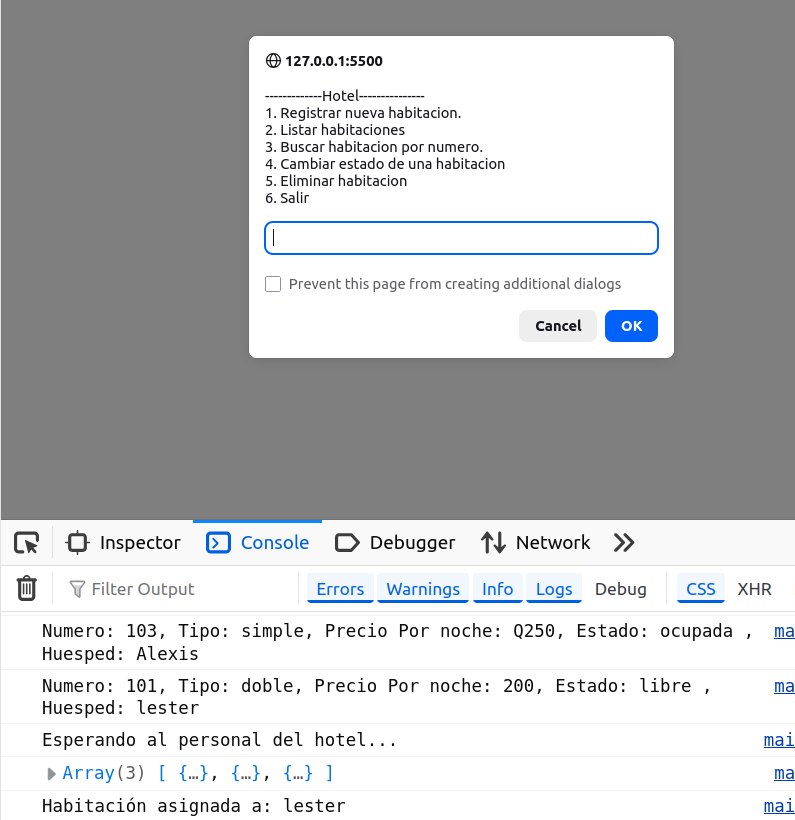
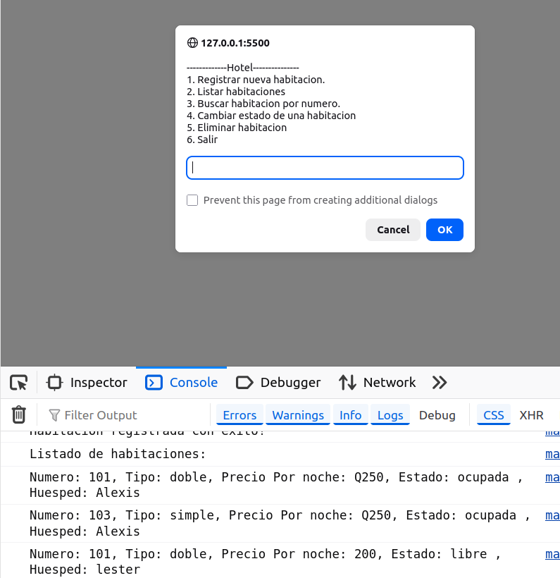
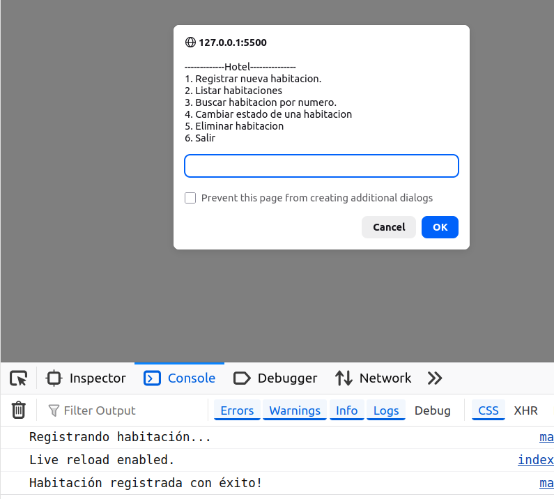

# Sistema de Hotel Miraflores

Sistema de gestion de habitaciones de un hotel, construido con JavaScript puro y **sin interfaz grafica**. La interaccion se realiza mediante cuadros de dialogo (`prompt`) y los resultados se muestran en la consola del navegador.

Proyecto desarrollado como taller de JavaScript. El objetivo es practicar el manejo de datos, funciones, callbacks y asincronia, priorizando la claridad del codigo y las decisiones de diseno.

## Contenido

- [Funcionalidades](#funcionalidades)
- [Ejecucion](#ejecucion)
- [Estructura del proyecto](#estructura-del-proyecto)
- [Modelo de datos](#modelo-de-datos)
- [Como esta construido y por que](#como-esta-construido-y-por-que)
- [Reglas de negocio](#reglas-de-negocio)
- [Limitaciones](#limitaciones)
- [Convencion de commits](#convencion-de-commits)
- [Evidencia](#evidencia)

## Funcionalidades

| Opcion | Operacion | Descripcion |
| ------ | --------- | ----------- |
| 1 | Registrar habitacion | Solicita numero, tipo, precio y estado inicial. |
| 2 | Listar habitaciones | Muestra todas las habitaciones en una tabla. |
| 3 | Buscar por numero | Consulta una habitacion y muestra su detalle. |
| 4 | Cambiar estado | Cambia entre Disponible, Ocupada y Mantenimiento. |
| 5 | Eliminar habitacion | Elimina una habitacion previa confirmacion. |
| 6 | Salir | Finaliza el programa. |

Pulsar **Cancelar** en cualquier cuadro de dialogo aborta la operacion actual sin modificar datos. En el menu principal equivale a salir.

## Ejecucion

No requiere instalacion ni dependencias.

1. Abrir `index.html` en el navegador. Se recomienda la extension Live Server de Visual Studio Code.
2. Abrir la consola del navegador con `F12` y seleccionar la pestana **Consola**.
3. Responder los cuadros de dialogo del menu. Los resultados aparecen en la consola.

## Estructura del proyecto

```
.
├── index.html   Pagina minima que carga el script
├── main.js      Toda la logica del sistema
├── README.md    Documentacion
└── img/         Capturas de evidencia
```

`main.js` esta dividido en cinco secciones, indicadas con comentarios:

1. **Configuracion y datos:** constantes, valores permitidos y datos iniciales.
2. **Utilidades de entrada:** lectura y validacion de lo que escribe el usuario.
3. **Utilidades de salida:** formato de precios y habitaciones.
4. **Operaciones del hotel:** una funcion por cada opcion del menu.
5. **Menu principal e inicio:** `mostrarMenu()` y la llamada que arranca el programa.

## Modelo de datos

Cada habitacion es un objeto dentro del arreglo `habitaciones`:

```js
{
    numero: "101",            // string, solo digitos, unico
    tipo: "Doble",            // Simple | Doble | Suite
    precioPorNoche: 250,      // number, mayor que cero
    estado: "Ocupada",        // Disponible | Ocupada | Mantenimiento
    huesped: "Alexis"         // nombre, "Ninguno" o "Bajo reparacion"
}
```

## Como esta construido y por que

**Callbacks para encadenar operaciones.** Cada operacion recibe una funcion `callback` que ejecuta al terminar; el menu se pasa como ese callback. Asi el menu reaparece solo cuando la operacion finalizo, incluso si esta tardo por un `setTimeout`.

**`setTimeout` para simular latencia.** Las operaciones de escritura y consulta esperan un par de segundos, como lo haria un sistema real que consulta una base de datos. Es una simulacion didactica: permite practicar asincronia sin servidor.

**Validacion centralizada.** Las funciones `pedirTexto`, `pedirPrecio`, `pedirOpcion` y similares encapsulan la lectura de datos. Repiten la pregunta hasta recibir un valor valido y devuelven `null` si el usuario cancela. De esta forma las operaciones no repiten validaciones y nunca guardan datos incompletos.

**Listas cerradas para tipo y estado.** El usuario elige un numero de una lista en lugar de escribir texto libre. Esto evita variantes como "ocupada", "Ocupada" y "OCUPADA", y mantiene los datos consistentes.

**Constantes en lugar de textos repetidos.** `ESTADOS`, `TIPOS` y los tiempos de espera se definen una sola vez. Cambiar un valor requiere editar un unico lugar.

**Una sola funcion para aplicar estados.** `aplicarEstado` actualiza el estado y el huesped de forma coherente. La usan tanto el registro como el cambio de estado, por lo que ambas operaciones siguen exactamente las mismas reglas.

**Precio como numero.** Guardar `250` en vez de `"Q250"` permite validar y operar con el valor. El simbolo de moneda se agrega solo al mostrarlo (`formatearPrecio`).

**Llamada a `mostrarMenu()` al final del archivo.** Garantiza que todas las constantes y funciones esten definidas antes de iniciar el programa.

## Reglas de negocio

- El numero de habitacion es unico y solo admite digitos.
- El precio por noche debe ser mayor que cero.
- El registro siempre solicita el nombre del huesped. Es obligatorio si la habitacion esta Ocupada; en otros estados puede dejarse vacio y queda "Ninguno" (o "Bajo reparacion" en Mantenimiento).
- Al cambiar una habitacion a Ocupada se solicita el nombre del huesped.
- Una habitacion Ocupada no puede eliminarse; primero debe cambiarse su estado.
- La eliminacion requiere confirmacion porque es irreversible.

## Limitaciones

- Los datos viven en memoria: se pierden al recargar la pagina.
- No hay reservas por fechas ni calculo de estancias.
- La interfaz depende de `prompt`, por lo que debe ejecutarse en un navegador.

## Convencion de commits

El historial sigue la especificacion [Conventional Commits](https://www.conventionalcommits.org/):

```
<tipo>(<alcance opcional>): <descripcion en imperativo>
```

Tipos usados: `feat`, `fix`, `refactor`, `docs`, `chore`.

## Evidencia

Capturas de la ejecucion del sistema en la consola del navegador.




