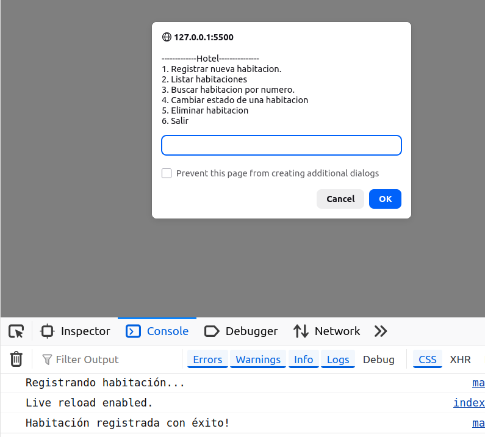
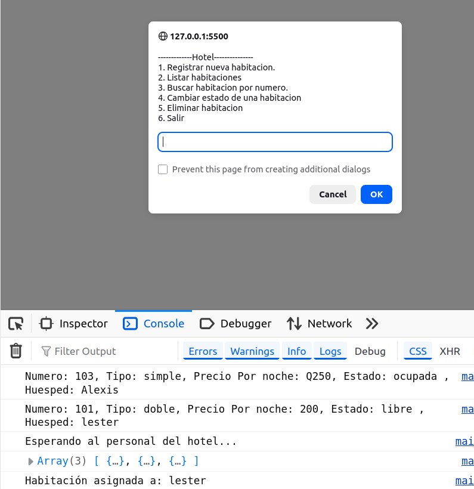
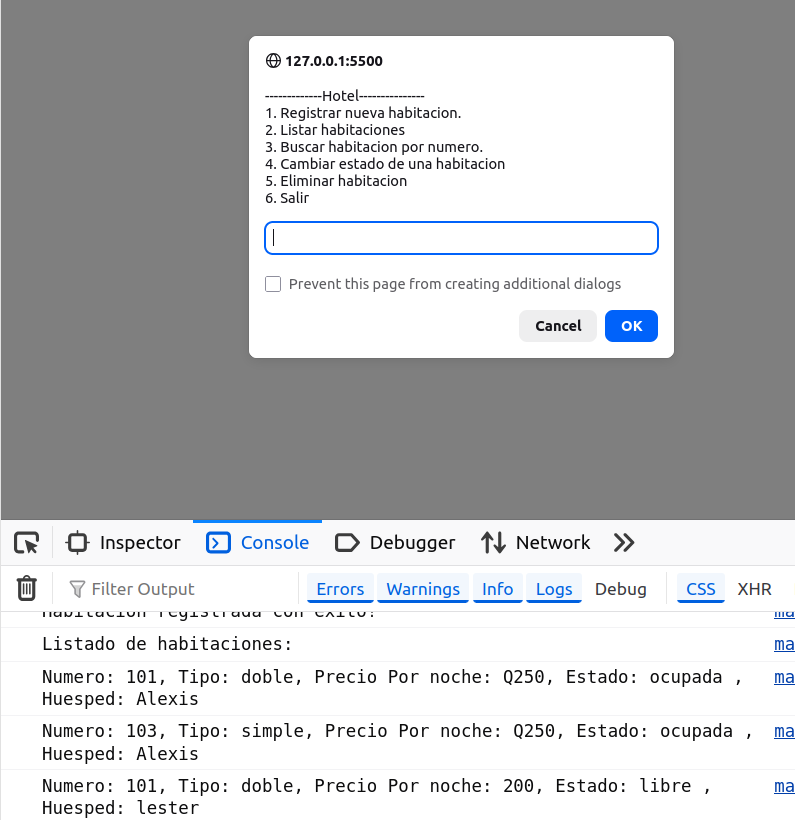

#  🚀Taller de Java Script(Sistema para un hotel.)
## Descripcion:
En este taller, dejé de lado las interfaces visuales para sumergirme de lleno en la arquitectura de datos, utilizando la consola del navegador como mi lienzo principal. El reto consistió en desarrollar un sistema de registro de hotel funcional, aplicando los pilares fundamentales de JavaScript.
## 🛠️ Herramientas utilizadas:
** Visual code
** Java Script
** Git Hub
** Html
** Inteligencia artificial
** Navegador fire ( Ejecución)

## 📦Ejecucion del programa:
1- Debes ubicarte en el html y desde alli ejecutarlo en el navegador con live server.

2- Luego si quieres ver el proceso en consola puedes hacerlo con el comando o tecla F12 o en modo inspeccionar ubicandote en la pagina y dandole click derecho y ponlo en modo inpeccionar y luego en consola.

3-Empieza a realizar lo que deseas dentro del sistema(simulacion)

## 🤝Aprendizajes:
Al desarrollar una simulación de un sistema de hotel utilizando únicamente JavaScript y la consola, el aprendizaje trasciende la sintaxis básica de todo un panorama con el usuario.

Aplicar los conocimientos adquiridos en clase.

## 📖 Evidencia del trabajo:

